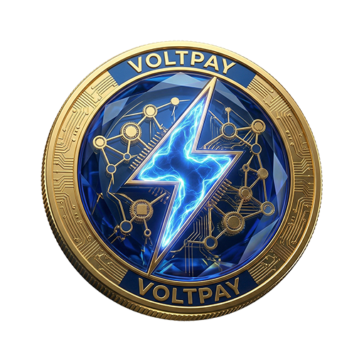

  

<h1 align="center">VoltPay (VLT) — Official Smart Contract Repository ⚡</h1>

  <strong>BNB Smart Chain • Web3 Payments • Non-Custodial Wallet • VoltAI</strong>

  <a href="https://voltpay.org">Website</a> •
  <a href="https://bscscan.com/address/0xE90714e6e4becEc65F33D3099F95B42B6e3168aE#code">BscScan</a> •
    <a href="https://voltpay.org/transparency">Transparency</a>

---

VoltPay is a Web3 payments ecosystem being developed to make digital-asset payments simpler by combining blockchain infrastructure, a non-custodial wallet, and AI-assisted user tools.

This repository contains the **official verified VoltPay V2 Mainnet smart contract**, updated VLT token allocation information, historical documentation, and security references.

---

## 📄 Verified Smart Contract

| Parameter | Official Value |
| --- | --- |
| **Network** | BNB Smart Chain (BSC Mainnet) |
| **Chain ID** | `56` |
| **VLT Contract** | `0xE90714e6e4becEc65F33D3099F95B42B6e3168aE` |
| **VLT / WBNB Pair** | `0x6cFF8650a2e8Affd64a48eaf227A0C74cE767892` |
| **PancakeSwap V2 Router** | `0x10ED43C718714eb63d5aA57B78B54704E256024E` |
| **Compiler** | Solidity `0.8.35` |
| **Optimizer** | Enabled — `200 runs` |
| **EVM Version** | `paris` |
| **BscScan Verification** | **Exact Match** |
| **Trading Status** | Enabled on-chain — DEX launch pending liquidity |
| **Liquidity Status** | Initial PancakeSwap V2 liquidity not yet added |

### 🔎 BscScan

[**View the verified VLT smart contract on BscScan →**](https://bscscan.com/address/0xE90714e6e4becEc65F33D3099F95B42B6e3168aE#code)

---

## 🔐 Frozen Contract Source

Official Mainnet source:

`VoltPayV2_FINAL_0_8_35.sol`

**SHA-256**

`9d708e7e874bdf72533d1f59d976049dfeeff9f3555aeccfd4c2bfdc94cbcdae`

The Solidity source is frozen and corresponds to the contract deployed and verified on BNB Smart Chain Mainnet.

Documentation, token allocation, presale parameters, locks, vesting schedules, and ecosystem updates do not modify the deployed smart contract or its fixed total supply.

---

## 📊 Tokenomics — Updated November 9, 2026

VoltPay (VLT) has a fixed, non-inflationary total supply of **200,000,000 VLT** on BNB Smart Chain.

Following the conclusion of the GemPad presale, the token allocation was updated to reflect the return of unused presale tokens, a new long-term Ecosystem Reserve Lock, and dedicated wallets for unlocked allocations.

**Total Supply:** 200,000,000 VLT (100%)

**Locked & Vesting:** 147,000,000 VLT (73.5%)

**Unlocked Allocations:** 53,000,000 VLT (26.5%)

### Current Token Allocation

| Allocation | VLT Amount | Share | Status |
| --- | ---: | ---: | --- |
| Strategic Reserve | 100,000,000 | 50% | Locked |
| Founder — Locked | 10,000,000 | 5% | Locked |
| Team Allocation | 10,000,000 | 5% | Vesting |
| Strategic Investor Allocation | 2,000,000 | 1% | Vesting |
| Ecosystem Reserve | 25,000,000 | 12.5% | Locked |
| Liquidity Reserve & Launch Preparation | 20,000,000 | 10% | Unlocked |
| Founder — Unlocked | 10,000,000 | 5% | Unlocked |
| Marketing & Community | 7,000,000 | 3.5% | Unlocked |
| Exchange Listings | 6,000,000 | 3% | Unlocked |
| Development & Operations | 5,000,000 | 2.5% | Unlocked |
| Future Funding | 5,000,000 | 2.5% | Unlocked |
| **Total** | **200,000,000** | **100%** | |

### Lock & Reserve Overview

- **147,000,000 VLT** is allocated to publicly verifiable token locks and vesting arrangements.
- The **25,000,000 VLT Ecosystem Reserve Lock** was created on November 9, 2026, with an unlock date of November 9, 2027, at 12:00 UTC.
- The **20,000,000 VLT liquidity allocation** comprises 18,000,000 VLT in a dedicated Liquidity Reserve wallet and 2,000,000 VLT in the Mainnet Deployer wallet for launch preparation.
- The **10,000,000 VLT unlocked Founder allocation** is disclosed separately from the 10,000,000 VLT locked Founder allocation.
- All unlocked reserve allocations are held in separately disclosed wallets and are not subject to token time locks.

Unlocked allocation amounts should not automatically be interpreted as circulating supply or deployed exchange liquidity.

The fixed total supply remains unchanged. No additional VLT tokens were minted as part of this restructuring.

For public wallet addresses, token locks, vesting records, and verification links, visit the [official VLT Transparency page](https://voltpay.org/transparency).

---

## 🚀 Presale Status — Completed

The VLT presale on GemPad has officially ended.

The presale did not reach its required soft cap and was therefore not completed as a successful fundraising event.

| Parameter | Final Status |
| --- | --- |
| **Platform** | GemPad |
| **Network** | BNB Smart Chain |
| **Status** | Ended — Soft Cap Not Reached |
| **Soft Cap** | 26 BNB |
| **Presale Price** | $0.0068 / VLT |
| **Original Target Listing Price** | $0.0076 / VLT |
| **Presale Outcome** | Unsuccessful |

### Token Allocation Update

Following the unsuccessful presale, the allocated VLT tokens were returned to the project.

On November 9, 2026, the token allocation was reorganized, including:

- Creation of a new 25,000,000 VLT Ecosystem Reserve Lock.
- Distribution of unlocked tokens into dedicated project and founder wallets.
- Publication of the updated allocation structure.

The total token supply remains unchanged at **200,000,000 VLT**.

Presale participants may follow the applicable refund process through GemPad. Individual refund transactions should be verified on-chain.

### Historical Presale Record

[**View the completed GemPad presale →**](https://gempad.app/presale/0x032864D4e771C147Da9619D4359ab5f1bAf3a5cA?network=BNB_Smart_Chain)

### Next Stage — PancakeSwap V2

VoltPay is preparing for the VLT decentralized exchange launch on PancakeSwap V2.

Initial liquidity deployment and LP token locking will be announced after the relevant on-chain transactions have been completed and verified.

**Current Status:** Preparing for DEX Launch.

---

## 💰 Fee Model

VoltPay uses a transaction-based fee structure:

- **Buy Fee:** `2%`
- **Sell Fee:** `4%`

Collected fees accumulate in the smart contract and are processed through the `processFees()` mechanism.

Processed fees are allocated:

- **50% → Liquidity**
- **50% → Treasury**

This design separates fee accumulation from normal user transfers and supports controlled liquidity and treasury processing.

---

## 🛡️ Security Validation

VoltPay V2 completed extensive internal testing and automated security validation before Mainnet deployment:

- ✅ `93/93` local Hardhat tests passed
- ✅ BSC Mainnet fork test passed
- ✅ Total automated result: `94/94 PASS`
- ✅ Mythril security analysis completed
- ✅ SolidityScan Security Score: `93.18`
- ✅ Critical findings: `0`
- ✅ High findings: `0`
- ✅ Medium findings: `0`
- ✅ Live BSC Testnet validation completed
- ✅ Buy fee validation: PASS
- ✅ Sell fee validation: PASS
- ✅ Anti-whale validation: PASS
- ✅ Fee processing validation: PASS
- ✅ Treasury pull-payment validation: PASS
- ✅ Post-renounce fee processing validation: PASS

These results are internal and automated validation references and are not a substitute for an independent third-party audit.

### ✅ Independent Smart Contract Audit — Cyberscope

VoltPay V2 has completed an independent smart contract security audit conducted by **Cyberscope**.

**Published Audit Findings:**
- Critical: 0
- Medium: 1
- Minor / Informational: 7

The audit findings and their current resolution status are publicly available in the official Cyberscope report.

[**View Official Cyberscope Audit →**](https://app.cyberscope.io/audits/10-vlt)

### ✅ Project KYC — Cyberscope

VoltPay has also completed the Cyberscope KYC verification process.

**KYC Status:** Verified

[**Verify KYC on Cyberscope →**](https://app.cyberscope.io/audits/10-vlt)

The smart contract audit and KYC verification provide independent documentation of the reviewed contract and identity verification. They do not constitute a guarantee of complete security, future performance, or investment returns.

---

## 🔒 Contract Safety Features

VoltPay V2 includes:

- Fixed non-inflationary supply
- No minting function
- One-way trading activation
- Fees can only be reduced
- Permanent fee locking
- Permanent configuration locking
- Permanent swap-settings locking
- Removable anti-whale limits
- Manual fee processing
- Pull-payment treasury mechanism
- Controlled ownership renouncement process

---

## 🌐 VoltPay Ecosystem

VoltPay is being developed as more than a standalone token.

The ecosystem includes:

- ⚡ **VLT** — the native VoltPay utility and payment token
- 👛 **VoltPay Wallet** — non-custodial digital-asset wallet
- 🤖 **VoltAI** — AI-assisted user experience
- ✈️ **Telegram Ecosystem** — wallet and community integrations
- 💳 **Payment Infrastructure** — future merchant and payment integrations

### Live / Deployed

- VLT Mainnet smart contract deployed and verified on BNB Smart Chain
- Official VoltPay website
- Public VoltPay community and social channels
- Mainnet fork testing completed
- BSC Testnet validation completed
- Automated security validation completed

### Pre-Launch / Continuing Development

- VoltPay Wallet development and refinement
- Telegram wallet integration
- VoltAI development and integration
- PancakeSwap V2 DEX launch preparation
- Launch documentation
- Security and production-readiness work

### Planned / Partner-Dependent

- Fiat on-ramp integrations
- Mobile wallet distribution
- Chrome wallet extension
- Merchant payment integrations
- Sponsored VLT transfers
- Ecosystem integrations
- Exchange partnerships

Future availability may depend on technical testing, security reviews, regulatory requirements, funding, and third-party approvals.

---

## 📚 Official Documents

### ✅ Current Official Documentation — November 2026

The official VoltPay (VLT) documentation has been updated to Version 3.1, reflecting the November 9, 2026 token allocation restructuring.

**Official Whitepaper — Version 3.1**

[**View / Download Whitepaper V3.1 →**](./docs/current/VoltPay_VLT_Whitepaper_Version_3.1_November_2026_Revised.pdf)

**Official Tokenomics — Version 3.1**

[**View / Download Tokenomics V3.1 →**](./docs/current/VoltPay_VLT_Tokenomics_Version_3.1_November_2026.pdf)

### Updated Token Allocation

| Category | Amount | Share |
| --- | ---: | ---: |
| Total Supply | 200,000,000 VLT | 100% |
| Locked & Vesting | 147,000,000 VLT | 73.5% |
| Unlocked Allocations | 53,000,000 VLT | 26.5% |

The updated documents include dedicated reserve wallet addresses, token lock and vesting records, Cyberscope audit and KYC references, and the current PancakeSwap V2 launch preparation status.

### Security & Verification

- [**Cyberscope Smart Contract Audit →**](https://app.cyberscope.io/audits/10-vlt)
- [**Official VLT Transparency →**](https://voltpay.org/transparency)
- [**PinkLock Verification →**](https://www.pinksale.finance/pinklock/bsc/0xE90714e6e4becEc65F33D3099F95B42B6e3168aE)

### 📦 Historical Documentation

The previous September 2026 V3.0 Rev2 documents have been moved to the historical archive.

- [**Whitepaper V3.0 Rev2 — Historical →**](./docs/archive/VoltPay_VLT_Whitepaper_Version_3.0_Presale_Edition_September_2026_Rev2.pdf)
- [**Tokenomics V3.0 Rev2 — Historical →**](./docs/archive/VoltPay_VLT_Tokenomics_Version_3.0_Presale_Edition_September_2026_Rev2.pdf)

[**View Complete Documentation Archive →**](./docs/archive/)

**Version 3.1 — November 2026 is the current official VLT documentation.**

---
## 🔎 Transparency

VoltPay publishes verifiable on-chain references for token locks, vesting schedules, liquidity, presale-related allocations, and other relevant project reserves.

Detailed lock and vesting records are maintained separately from the primary project documentation so verification links can remain current.

### Official Transparency Page

[**voltpay.org/transparency →**](https://voltpay.org/transparency)

Additional on-chain references, including liquidity and presale records, will be added as they become available.

---

## 🔗 Official VoltPay Links

| Channel | Official Link |
| --- | --- |
| 🌐 **Website** | https://voltpay.org |
| ✉️ **Email** | info@voltpay.org |
| 💻 **GitHub** | https://github.com/volt-pay |
| 𝕏 **X / Twitter** | https://x.com/VoltPayInfo |
| ✈️ **Telegram** | https://t.me/VoltPayorg |
| ▶️ **YouTube** | https://www.youtube.com/channel/UCUagEhm_XXi0AoGi0AOYseQ |
| 🎵 **TikTok** | https://www.tiktok.com/@voltpay.org |
| 📸 **Instagram** | https://www.instagram.com/voltpay.info/ |

---

## ⚠️ Disclaimer

Cryptocurrency markets involve substantial risk.

VoltPay does not guarantee token price appreciation, investment returns, market liquidity, presale completion, product delivery dates, partnership approvals, or future exchange listings.

Users should independently review the smart contract, updated token allocation, official transparency records, and available on-chain data before interacting with VLT.
Nothing in this repository constitutes financial, legal, tax, or investment advice.

---

  <strong>VoltPay (VLT) — Official Token Repository</strong>

  Powered by BNB Smart Chain • <a href="https://voltpay.org">voltpay.org</a>

